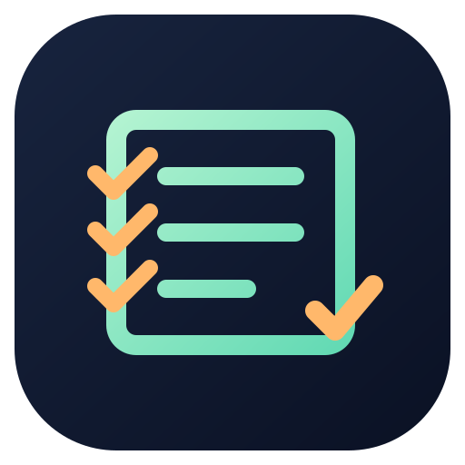

<div align="center">



# Fully Prepared

### A calm, local-first cockpit for better conversations

Capture context. Prepare with confidence. Stay present.

[](https://github.com/Amhatre-15/Fully_Prepared/releases/tag/v1.0.0)
[](https://github.com/Amhatre-15/Fully_Prepared)
[](LICENSE)

</div>

## What it is

Fully Prepared is an independent desktop conversation assistant for interviews, meetings, and practice sessions. It keeps preparation, notes, documents, transcripts, and guidance close at hand while keeping sensitive data local by default.

## Highlights

- **Call Sessions** — Searchable Interview, Regular, and Mock session dashboard with sorting, transcript actions, export, deletion confirmation, and interrupted-session recovery.
- **Context-aware preparation** — Build a session from a company, role, session type, resume, and local documents with draft recovery.
- **Live guidance** — Model-generated questions, answer coaching, system speech, multilingual microphone input, and a local Whisper.cpp transcription bridge.
- **Local libraries** — Resumes, Documents, Question Bank, Resume Maker, and Headshots with explainable role-specific review and offline English OCR for scanned PDFs.
- **Flexible model connections** — Ollama and OpenAI-compatible model discovery/chat through Electron's isolated main-process bridge.
- **Privacy-minded defaults** — Local settings, drafts, and transcripts; API keys use Electron `safeStorage` where device encryption is available; crash diagnostics are opt-in and allowlisted.
- **Hardened Electron shell** — Context isolation, no Node integration in the renderer, validated IPC, and microphone-only media permission.

## Quick start

```powershell
npm install
npm start
```

Run the automated checks with:

```powershell
npm test
```

The test suite uses Node's built-in test runner and a local mock provider. It does not require an API key or make external requests.

## Windows portable package

After `npm install`, build the portable package with:

```powershell
npm run build:windows
```

The package is written to `dist/fully-prepared-windows-portable`. It includes Electron, application dependencies, the Whisper.cpp runtime, and applicable runtime notices. Run `Fully Prepared.exe` directly, or extract the package and run `install.ps1` for a per-user Start Menu installation.

The portable build is not code-signed, does not auto-update, and has not yet been validated on a clean Windows account. Review the release gates in [`docs/RELEASE_POLICY.md`](docs/RELEASE_POLICY.md) before redistribution.

## Project status

Version 1.0 is a local-first product foundation with manual updates. Dashboard/navigation E2E coverage is included, while clean-account installation and real CPU/GPU model inference on target hardware remain release checks. Public Windows distribution requires the publisher's trusted code-signing certificate.

More detail:

- [`docs/FEATURE_STATUS.md`](docs/FEATURE_STATUS.md) — feature readiness
- [`docs/USER_GUIDE.md`](docs/USER_GUIDE.md) — user workflows
- [`docs/PRIVACY.md`](docs/PRIVACY.md) — data handling
- [`docs/SECURITY_AUDIT.md`](docs/SECURITY_AUDIT.md) — security notes
- [`docs/PROGRESS.md`](docs/PROGRESS.md) — development progress
- [`docs/THIRD_PARTY_NOTICES.md`](docs/THIRD_PARTY_NOTICES.md) — dependency notices

## Repository notes

Generated dependencies and portable build outputs are intentionally excluded from Git. The Whisper model and packaged runtime archives are excluded because GitHub's regular repository limit does not accept files larger than 100 MB. Install dependencies with `npm install` and recreate local build artifacts with the commands above.

## License

Fully Prepared is released under the [MIT License](LICENSE).

<div align="center">

Made for clearer thinking when the conversation matters.

</div>
